# rack-parts catalog

Parametric, printable rack accessories from [`rack-parts/`](https://github.com/crew-exchange-2079/goblin-workshop/blob/main/rack-parts). Every part is generated from a JSON file of **your own measurements**, validated (refused with exit code 2 if inconsistent), rendered with OpenSCAD, mesh-checked, spec-checked against the features it must have, and exported as STL and 3MF.

> **Synthetic examples, no rating.** Every picture below comes from a made-up example file, not a real rack or device. Nothing here has been printed, load-tested or installed; there is no strength, load, heat, fire or fit rating. Measure your own rack, devices, screws and printer.

Previews are orthographic renders of the checked mesh (front-left, from above); they are not to scale with each other and are not for measurement. Sizes are the bounding box *x* (across) x *y* (depth) x *z* (height) in mm from the validator.

| part | `part` value | what it is | inputs (measured / chosen / tolerance) |
|---|---|---|---|
| [Rack bracket](#rack-bracket) | `rack_bracket` | L-shaped rack ear: front flange on the rails, side flange on the device. | 9 / 9 / 5 |
| [SFF PC cradle](#sff-cradle) | `sff_cradle` | U-shaped cradle with retention lip for a small-form-factor PC or box. | 9 / 8 / 2 |
| [Switch cradle](#switch-cradle) | `switch_cradle` | Drop-in cradle for a small switch: stop tabs, strap slots, vent windows. | 14 / 12 / 4 |
| [Blanking panel](#blanking-panel) | `blanking_panel` | Flat rack panel on measured rail holes, optional stiffening ribs. | 7 / 7 / 3 |
| [Cable pass-through panel](#cable-panel) | `cable_panel` | Rack panel with stadium cable openings, edges rounded on both faces. | 8 / 11 / 3 |
| [Keystone patch panel](#keystone-panel) | `keystone_panel` | Rack panel with rows of snap-in keystone cutouts, thinned from the back to the thickness the jack latch grips. | 12 / 10 / 4 |
| [Rack shelf (10-inch)](#rack-shelf) | `rack_shelf` | Shallow ventilated cantilever shelf hanging from the front rail screws. | 12 / 13 / 4 |
| [Rack drawer (10-inch)](#rack-drawer) | `rack_drawer` | Housing with a closed sleeve on the front rails plus a sliding drawer box with finger pull and dividers; both parts come from one file. | 9 / 14 / 4 |
| [PDU / power-strip mount](#pdu-mount) | `pdu_mount` | External strap-retained bracket that keeps clear of outlets, switch, vents and cord. | 15 / 8 / 4 |
| [Label holder](#label-holder) | `label_holder` | Slide-in card holder with a front window, optional screw ears. | 8 / 7 / 2 |
| [Cable comb](#cable-comb) | `cable_comb` | Bar of round cable seats behind entry throats; snap-in or drop-in. | 7 / 9 / 2 |
| [SFP / tape cartridge holder](#cartridge-holder) | `cartridge_holder` | Grid of upright pockets sized from your items, with push-out holes and finger notches. | 9 / 11 / 1 |

Generate any of them:

```sh
cd rack-parts
python3 -m rackparts generate examples/<example>-synthetic.json --out build/<example> --png
python3 -m rackparts spec-check build/<example>   # re-run the part's feature probes
```

<a id="rack-bracket"></a>

## Rack bracket

L-shaped rack ear: front flange on the rails, side flange on the device.

| example | size mm | notes |
|---|---|---|
| [`bracket-19in-1u`](https://github.com/crew-exchange-2079/goblin-workshop/blob/main/rack-parts/examples/bracket-19in-1u-synthetic.json) | 25.05 x 90 x 43.66 | - |
| [`bracket-10in-1u`](https://github.com/crew-exchange-2079/goblin-workshop/blob/main/rack-parts/examples/bracket-10in-1u-synthetic.json) | 25.25 x 70 x 43.66 | - |

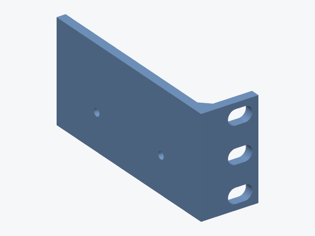
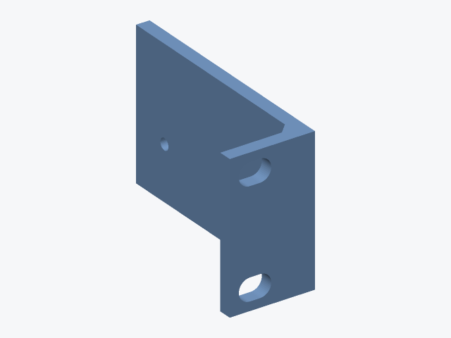

Parameters: [README, `rack_bracket`](https://github.com/crew-exchange-2079/goblin-workshop/blob/main/rack-parts/README.md#parameters).

<a id="sff-cradle"></a>

## SFF PC cradle

U-shaped cradle with retention lip for a small-form-factor PC or box.

| example | size mm | notes |
|---|---|---|
| [`sff-cradle`](https://github.com/crew-exchange-2079/goblin-workshop/blob/main/rack-parts/examples/sff-cradle-synthetic.json) | 189 x 120 x 70 | - |

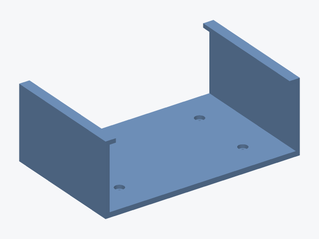

Parameters: [README, `sff_cradle`](https://github.com/crew-exchange-2079/goblin-workshop/blob/main/rack-parts/README.md#parameters).

<a id="switch-cradle"></a>

## Switch cradle

Drop-in cradle for a small switch: stop tabs, strap slots, vent windows.

| example | size mm | notes |
|---|---|---|
| [`switch-cradle`](https://github.com/crew-exchange-2079/goblin-workshop/blob/main/rack-parts/examples/switch-cradle-synthetic.json) | 167.2 x 107.2 x 39.6 | - |

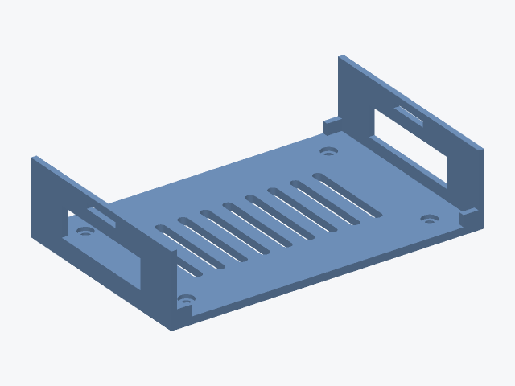

Parameters: [README, `switch_cradle`](https://github.com/crew-exchange-2079/goblin-workshop/blob/main/rack-parts/README.md#parameters).

<a id="blanking-panel"></a>

## Blanking panel

Flat rack panel on measured rail holes, optional stiffening ribs.

| example | size mm | notes |
|---|---|---|
| [`blank-10in-1u`](https://github.com/crew-exchange-2079/goblin-workshop/blob/main/rack-parts/examples/blank-10in-1u-synthetic.json) | 254 x 9 x 43.66 | - |
| [`blank-19in-1u`](https://github.com/crew-exchange-2079/goblin-workshop/blob/main/rack-parts/examples/blank-19in-1u-synthetic.json) | 482.6 x 11 x 43.66 | **does not fit** the stated 256 x 256 mm plate |

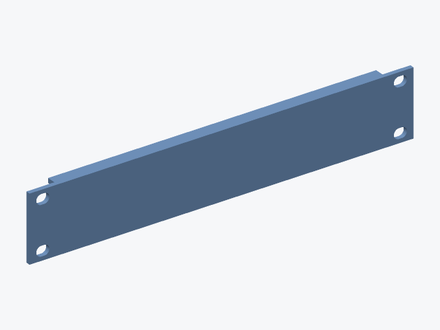


Parameters: [README, `blanking_panel`](https://github.com/crew-exchange-2079/goblin-workshop/blob/main/rack-parts/README.md#parameters).

<a id="cable-panel"></a>

## Cable pass-through panel

Rack panel with stadium cable openings, edges rounded on both faces.

| example | size mm | notes |
|---|---|---|
| [`cable-10in-1u`](https://github.com/crew-exchange-2079/goblin-workshop/blob/main/rack-parts/examples/cable-10in-1u-synthetic.json) | 254 x 10 x 43.66 | - |
| [`cable-19in-2u`](https://github.com/crew-exchange-2079/goblin-workshop/blob/main/rack-parts/examples/cable-19in-2u-synthetic.json) | 482.6 x 12 x 88.11 | **does not fit** the stated 256 x 256 mm plate |

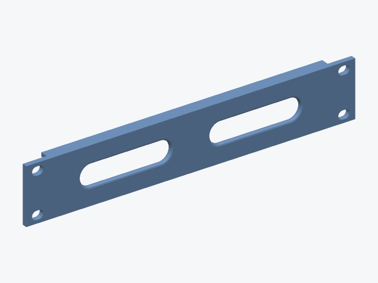
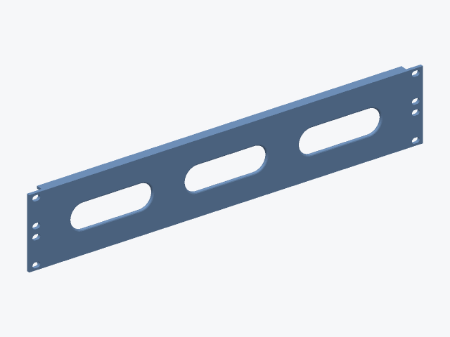

Parameters: [README, `cable_panel`](https://github.com/crew-exchange-2079/goblin-workshop/blob/main/rack-parts/README.md#parameters).

<a id="keystone-panel"></a>

## Keystone patch panel

Rack panel with rows of snap-in keystone cutouts, thinned from the back to the thickness the jack latch grips.

| example | size mm | notes |
|---|---|---|
| [`keystone-10in-1u`](https://github.com/crew-exchange-2079/goblin-workshop/blob/main/rack-parts/examples/keystone-10in-1u-synthetic.json) | 254 x 10 x 43.66 | 10 jacks; fit coupon required before use |
| [`keystone-19in-1u`](https://github.com/crew-exchange-2079/goblin-workshop/blob/main/rack-parts/examples/keystone-19in-1u-synthetic.json) | 482.6 x 12 x 43.66 | **does not fit** the stated 256 x 256 mm plate; 20 jacks; fit coupon required before use |

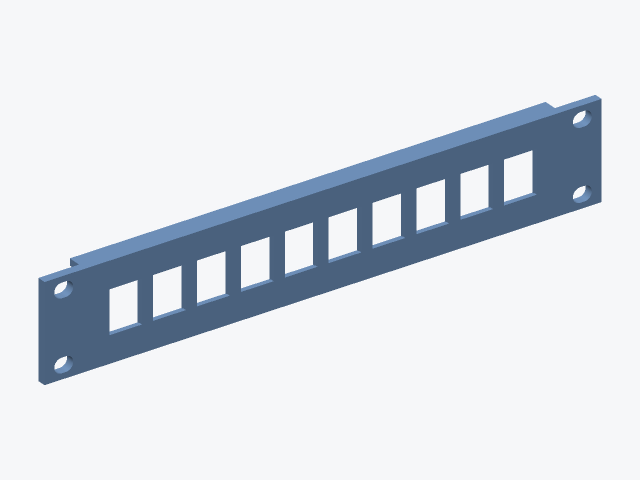
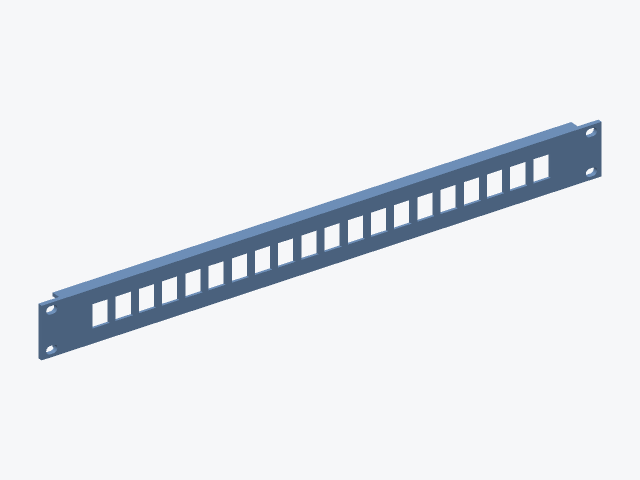

Parameters: [README, `keystone_panel`](https://github.com/crew-exchange-2079/goblin-workshop/blob/main/rack-parts/README.md#parameters).

<a id="rack-shelf"></a>

## Rack shelf (10-inch)

Shallow ventilated cantilever shelf hanging from the front rail screws.

| example | size mm | notes |
|---|---|---|
| [`shelf-10in-1u`](https://github.com/crew-exchange-2079/goblin-workshop/blob/main/rack-parts/examples/shelf-10in-1u-synthetic.json) | 254 x 154 x 43.66 | fit coupon required before use |
| [`shelf-10in-2u`](https://github.com/crew-exchange-2079/goblin-workshop/blob/main/rack-parts/examples/shelf-10in-2u-synthetic.json) | 254 x 224 x 88.1 | fit coupon required before use |

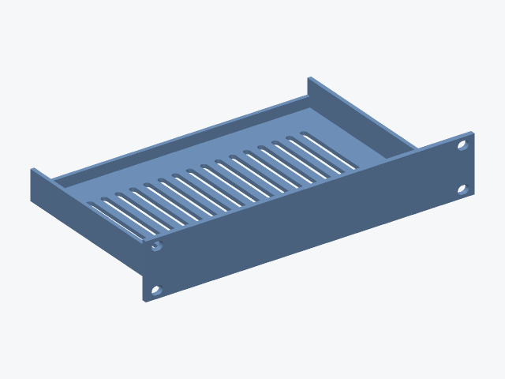
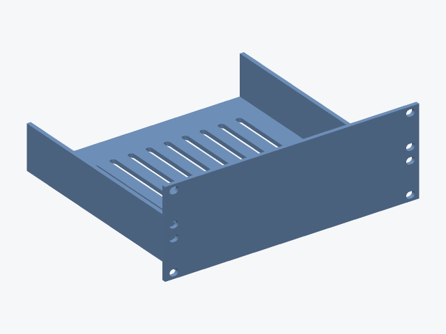

Parameters: [README, `rack_shelf`](https://github.com/crew-exchange-2079/goblin-workshop/blob/main/rack-parts/README.md#parameters).

<a id="rack-drawer"></a>

## Rack drawer (10-inch)

Housing with a closed sleeve on the front rails plus a sliding drawer box with finger pull and dividers; both parts come from one file.

| example | size mm | notes |
|---|---|---|
| [`drawer-10in-2u-housing`](https://github.com/crew-exchange-2079/goblin-workshop/blob/main/rack-parts/examples/drawer-10in-2u-housing-synthetic.json) | 254 x 164 x 88.1 | component `housing`; fit coupon required before use |
| [`drawer-10in-2u-drawer`](https://github.com/crew-exchange-2079/goblin-workshop/blob/main/rack-parts/examples/drawer-10in-2u-drawer-synthetic.json) | 218.2 x 164 x 78.2 | component `drawer`; fit coupon required before use |

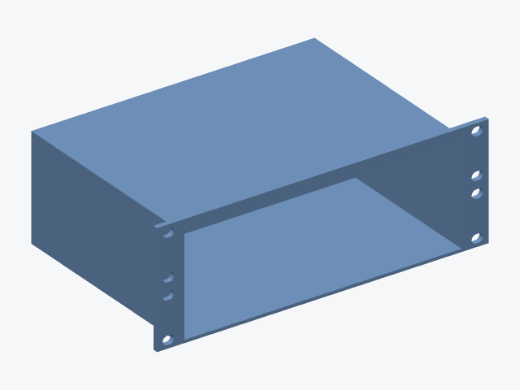
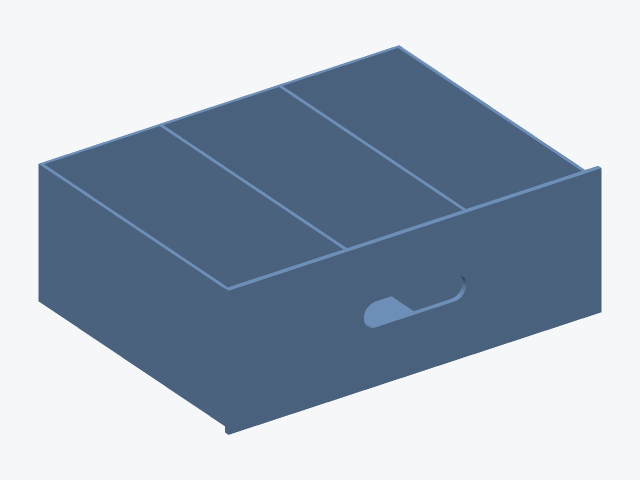

Parameters: [README, `rack_drawer`](https://github.com/crew-exchange-2079/goblin-workshop/blob/main/rack-parts/README.md#parameters).

<a id="pdu-mount"></a>

## PDU / power-strip mount

External strap-retained bracket that keeps clear of outlets, switch, vents and cord.

| example | size mm | notes |
|---|---|---|
| [`pdu-strip`](https://github.com/crew-exchange-2079/goblin-workshop/blob/main/rack-parts/examples/pdu-strip-synthetic.json) | 24 x 86.6 x 50.8 | print 2; fit coupon required before use |
| [`pdu-compact`](https://github.com/crew-exchange-2079/goblin-workshop/blob/main/rack-parts/examples/pdu-compact-synthetic.json) | 18 x 66 x 38.3 | print 2; fit coupon required before use |


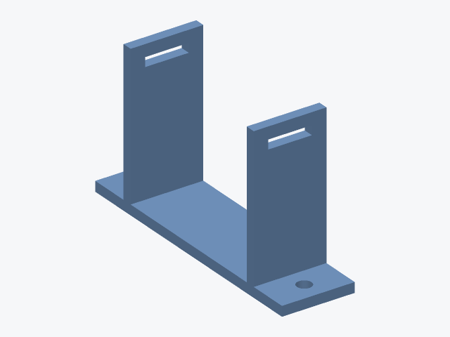

Parameters: [README, `pdu_mount`](https://github.com/crew-exchange-2079/goblin-workshop/blob/main/rack-parts/README.md#parameters).

<a id="label-holder"></a>

## Label holder

Slide-in card holder with a front window, optional screw ears.

| example | size mm | notes |
|---|---|---|
| [`label-card-ears`](https://github.com/crew-exchange-2079/goblin-workshop/blob/main/rack-parts/examples/label-card-ears-synthetic.json) | 85.6 x 4 x 22.8 | - |
| [`label-strip-adhesive`](https://github.com/crew-exchange-2079/goblin-workshop/blob/main/rack-parts/examples/label-strip-adhesive-synthetic.json) | 204.8 x 3.4 x 14.4 | - |

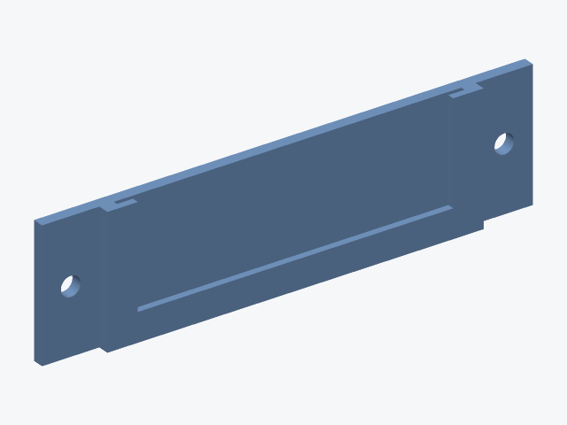
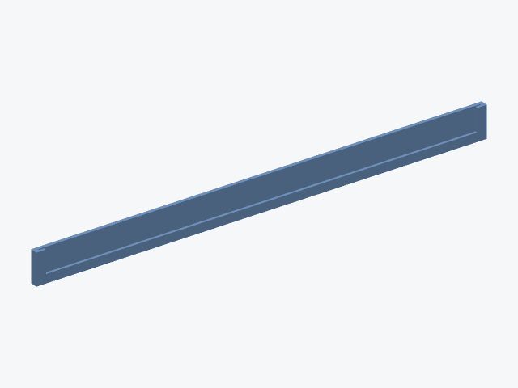

Parameters: [README, `label_holder`](https://github.com/crew-exchange-2079/goblin-workshop/blob/main/rack-parts/README.md#parameters).

<a id="cable-comb"></a>

## Cable comb

Bar of round cable seats behind entry throats; snap-in or drop-in.

| example | size mm | notes |
|---|---|---|
| [`comb-8x6mm-snap`](https://github.com/crew-exchange-2079/goblin-workshop/blob/main/rack-parts/examples/comb-8x6mm-snap-synthetic.json) | 88.61 x 6 x 22.61 | - |
| [`comb-12x3mm-open`](https://github.com/crew-exchange-2079/goblin-workshop/blob/main/rack-parts/examples/comb-12x3mm-open-synthetic.json) | 77.51 x 5 x 15.51 | - |

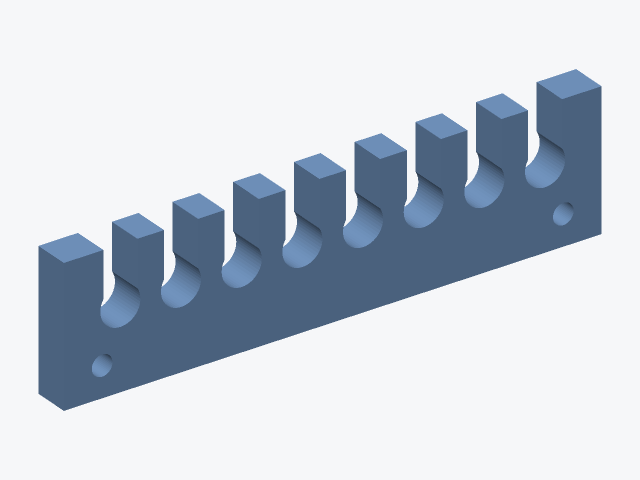
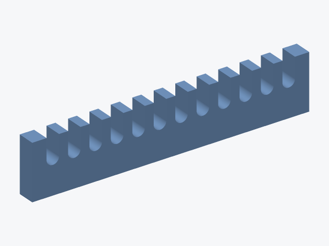

Parameters: [README, `cable_comb`](https://github.com/crew-exchange-2079/goblin-workshop/blob/main/rack-parts/README.md#parameters).

<a id="cartridge-holder"></a>

## SFP / tape cartridge holder

Grid of upright pockets sized from your items, with push-out holes and finger notches.

| example | size mm | notes |
|---|---|---|
| [`cartridge-tape-5`](https://github.com/crew-exchange-2079/goblin-workshop/blob/main/rack-parts/examples/cartridge-tape-5-synthetic.json) | 108.3 x 127.8 x 42.4 | 5 pockets |
| [`cartridge-sfp-12`](https://github.com/crew-exchange-2079/goblin-workshop/blob/main/rack-parts/examples/cartridge-sfp-12-synthetic.json) | 100.8 x 25.2 x 24 | 12 pockets |

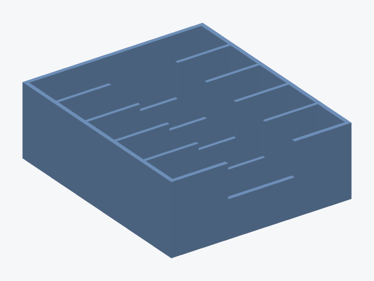
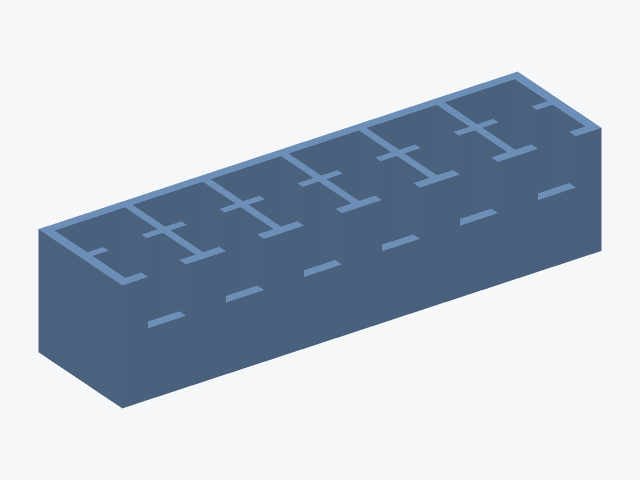

Parameters: [README, `cartridge_holder`](https://github.com/crew-exchange-2079/goblin-workshop/blob/main/rack-parts/README.md#parameters).

## Not checked

Strength, load, stiffness, heat, creep, fire and electrical behaviour, real-world fit, and whether a printed part is appropriate at all. See the [rack-parts README](https://github.com/crew-exchange-2079/goblin-workshop/blob/main/rack-parts/README.md) for what the validator and the spec checks do and do not cover.
