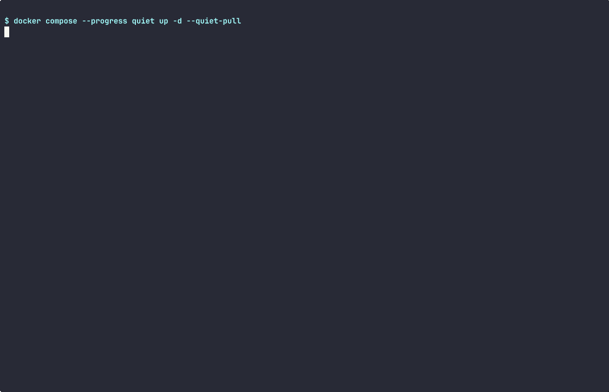

# exporter → Prometheus → Grafana

Runs [`tape-exporter`](../../tape-exporter/) against **synthetic** drive data,
has Prometheus scrape it and evaluate the repo's alert rules, and loads the
repo's Grafana dashboard. About a minute on a warm Docker cache. No tape
hardware, no devices, nothing privileged.



Recording: [`walkthrough.cast`](walkthrough.cast) (asciicast v2; `asciinema play walkthrough.cast`).

## Run it

Needs Docker with the compose plugin, and `python3` (3.10+) on the host.

```sh
cd examples/exporter-to-grafana
./walkthrough.sh            # leaves the stack up; open http://127.0.0.1:3000/d/lto-exporter-v1
docker compose down         # when you're done
```

`./walkthrough.sh --down` tears the stack down at the end. Ports 9101, 9090
and 3000 are published on `127.0.0.1` only. Change them with `EXPORTER_PORT`,
`PROMETHEUS_PORT` and `GRAFANA_PORT`.

## What's in the stack

| service | image (pinned by digest) | does |
|---|---|---|
| `exporter` | `python:3.13.16-alpine3.24` | the real `lto_exporter` Collector and HTTP handler, with `sg_logs` swapped for synthetic text from [`synthetic_target.py`](../../tape-exporter/ci/grafana/synthetic_target.py). `:9101` is healthy (`drive0`, and `drive1`, which needs cleaning). `:9102` is failing (`drive2`: unsupported page, timeout, not ready; `drive3`: device missing). |
| `prometheus` | `prom/prometheus:v3.14.0` | scrapes both every 2 s and loads [`lto-exporter-alerts.yml`](../../tape-exporter/monitoring/prometheus/lto-exporter-alerts.yml) unmodified |
| `grafana` | `grafana/grafana-oss:13.0.2` | provisions [`lto-exporter-dashboard.json`](../../tape-exporter/monitoring/grafana/lto-exporter-dashboard.json) unmodified. Anonymous Viewer only: no login form, no basic auth. |

The images and digests are the same ones the exporter's Grafana smoke test
uses, and `examples/tests` fails if they drift apart. Every container runs
read-only, with all capabilities dropped, `no-new-privileges` and a memory
limit. Repo files are bind-mounted read-only. Nothing is copied, so the
walkthrough always shows the dashboard and rules as they are in the tree.

## Steps, and the plain curl behind each

`peek.py` only shortens JSON into a few lines. Each step is one HTTP call:

| step | equivalent |
|---|---|
| `peek.py wait` | polls `GET :9090/api/v1/query?query=count_over_time(tape_exporter_build_info[1m]) >= 3` and `GET :3000/api/health` |
| `peek.py metrics` | `curl -s 127.0.0.1:9101/metrics \| grep -E '^tape_(cleaning_required\|data_bytes_total\|exporter_collector_success)'` |
| `peek.py targets` | `curl -s 127.0.0.1:9090/api/v1/targets` |
| `peek.py query EXPR` | `curl -s 127.0.0.1:9090/api/v1/query --data-urlencode "query=EXPR"` |
| `peek.py alerts` | `curl -s 127.0.0.1:9090/api/v1/alerts` |
| `peek.py dashboard` | `curl -s 127.0.0.1:3000/api/dashboards/uid/lto-exporter-v1`, then `POST :3000/api/ds/query` with the *Cleaning required* panel's own expression |

## What to look at

* **Metrics → alerts.** `tape_cleaning_required{device="drive1"} 1` shows up
  as `LTOCleaningRequired pending`. The rule has `for: 30m`, so in this short
  run it stays *pending* and never fires. That's the rule working as
  written, not a bug. The failing target's drives show up as
  `LTOCollectorFailing`, `LTOLogPageUnsupported` and `LTODeviceChanged`.
  Whether `LTOUncorrectedErrorsIncreased` is already firing depends on how
  many scrapes have landed, so the check doesn't rely on it. The check accepts
  `pending` or `firing` for every alert it looks at, since that depends only on
  how long the stack has been up.
* **Missing is not zero.** `drive1`'s read page leaves out
  `total_uncorrected`. The exporter reports it as absent
  (`LTOErrorParameterMissing`), never as 0.
* **Grafana reads the same series.** The *Cleaning required* panel query,
  sent through Grafana's datasource proxy, returns `drive1 = 1`.

## Tested

CI (`examples` job in [`.github/workflows/ci.yml`](../../.github/workflows/ci.yml))
runs `python3 examples/run_walkthrough.py exporter-to-grafana`. That runs this
`walkthrough.sh --down` in a pseudo-terminal on free ports under a throwaway
compose project, checks the output for the claims above, and fails if any
container is left behind. It also uploads a fresh recording of the run.
`examples/tests` (no Docker) checks the image pins, read-only mounts,
loopback-only ports, and that the committed recording matches the
commands in `walkthrough.sh`.

To re-record after changing the walkthrough:

```sh
python3 examples/run_walkthrough.py exporter-to-grafana --cast examples/exporter-to-grafana/walkthrough.cast
agg --idle-time-limit 2 --font-size 14 --last-frame-duration 6 \
    examples/exporter-to-grafana/walkthrough.cast examples/exporter-to-grafana/walkthrough.gif   # asciinema/agg 1.7.0
```

**Not shown:** a real drive. The exporter's device checks are stubbed out
here, as in the Grafana smoke test. See the
[exporter README](../../tape-exporter/README.md) for what has and hasn't been
tested against real hardware (none) and mhvtl (CI).
